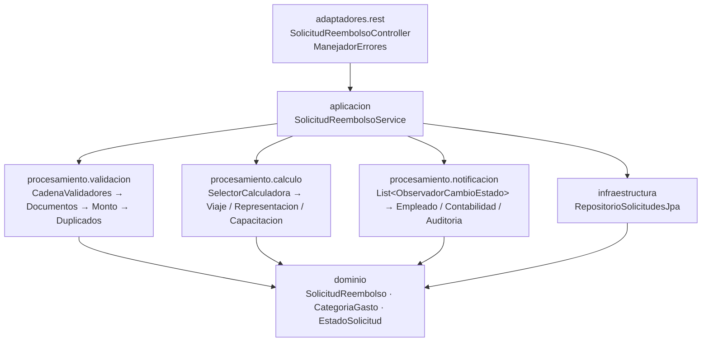
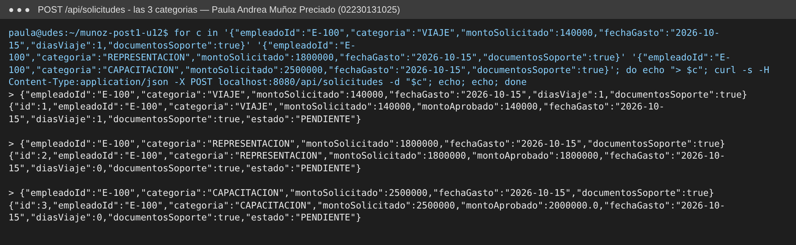
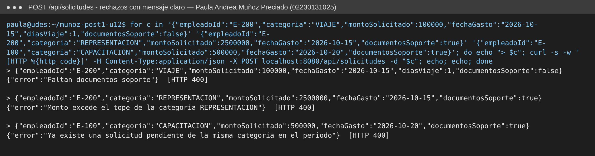
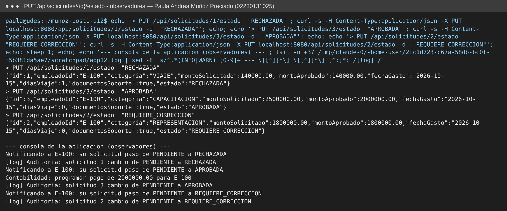
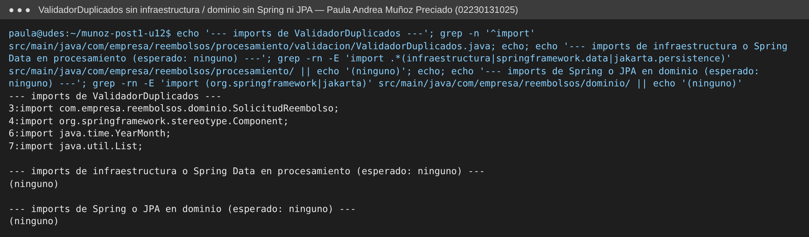
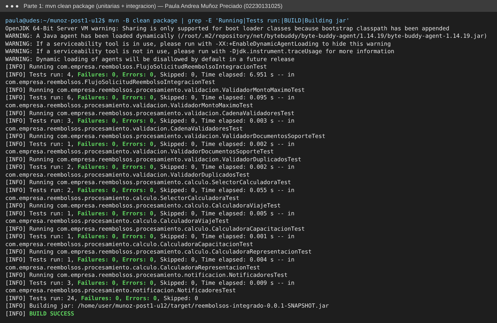
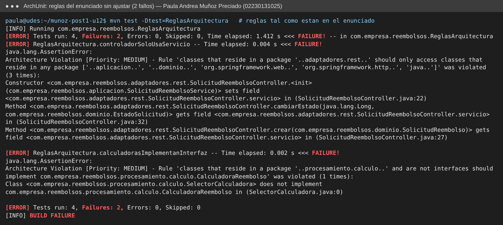
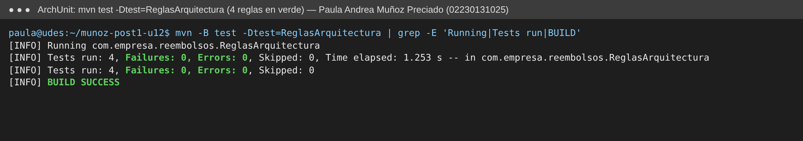

# Proyecto Integrador — Sistema de Solicitudes de Reembolso de Gastos Corporativos

| | |
|---|---|
| **Estudiante** | Paula Andrea Muñoz Preciado |
| **Código** | 02230131025 |
| **Programa** | Ingeniería de Sistemas — UDES |
| **Repositorio** | `munoz-post1-u12` |

Proyecto Maven / Spring Boot 3 (Java 17, Spring Web, Spring Data JPA, H2) ubicado en la raíz
del repositorio: `com.empresa:reembolsos-integrado`, paquete base `com.empresa.reembolsos`.

---

## Diseño Propuesto

> Esta sección se escribió **antes** de implementar cualquier patrón (primer commit del
> repositorio: `docs: analizar requisitos y proponer diseno de patrones antes de implementar`).
> Para cada requisito se identifica primero **qué varía**, y solo después qué patrón lo encapsula.

### Análisis de los requisitos

| Requisito | Lo que es estable | Lo que varía (punto de variabilidad) | Evidencia en la especificación |
|---|---|---|---|
| **RF1** Validación en varias etapas | "Una solicitud debe pasar verificaciones antes de aprobarse; si una falla, se rechaza con un motivo" | **El número y el tipo de verificaciones**, que se ejecutan en secuencia y donde cualquiera puede cortar el proceso | "planea agregar más verificaciones (límite anual acumulado) **sin modificar las existentes**" |
| **RF2** Cálculo por categoría | "A toda solicitud aceptada se le calcula un monto aprobado" | **La fórmula** de cálculo, una por categoría (tope diario × días, monto hasta tope mensual, 80 % hasta tope anual) | "agregar categorías nuevas (bienestar), cada una con su fórmula, **sin modificar el cálculo de las existentes**" |
| **RF3** Notificación simultánea | "Cuando una solicitud cambia de estado, se avisa" | **Quiénes** se enteran y **cómo reacciona** cada uno (empleado: todo; contabilidad: solo aprobadas; auditoría: todo sin excepción) | "el número de partes interesadas **puede crecer** (panel de métricas)" |

### Patrón propuesto para cada requisito

| Requisito | Patrón propuesto | Justificación (test de explicabilidad: una oración) |
|---|---|---|
| **RF1** | **Chain of Responsibility** (cadena de validadores) | Porque las verificaciones son pasos independientes que se ejecutan en orden y cualquiera puede detener el proceso con un motivo de rechazo, Chain of Responsibility permite agregar el "límite anual acumulado" como un eslabón nuevo sin tocar los validadores existentes. |
| **RF2** | **Strategy** (una calculadora por categoría, seleccionada por la categoría) | Porque lo único que cambia entre categorías es la fórmula y en cada solicitud se aplica exactamente una, Strategy encapsula cada fórmula en su propia clase y agregar "bienestar" es crear una clase nueva, no editar un `switch`. |
| **RF3** | **Observer** (observadores de cambio de estado) | Porque un mismo evento (cambio de estado) debe llegar a varios interesados que reaccionan de forma distinta y cuyo número crecerá, Observer deja que el servicio solo emita el evento mientras cada interesado decide qué hacer con él. |

### Por qué estos patrones y no otros (alternativas evaluadas)

- **RF1 — ¿por qué no Strategy o una simple `List<Validador>`?** Strategy elige *una* variante entre
  varias; aquí se aplican *todas* en secuencia, así que no encaja. Una lista recorrida con un `for`
  también funcionaría; se prefiere la cadena porque cada eslabón decide si corta o delega, y el
  **orden** queda explícito en un solo lugar (`CadenaValidadores`), lo que permite justificarlo por
  costo (Decisión de diseño 1). *Decorator* se descartó: no se agrega comportamiento a un objeto,
  se filtra una solicitud.
- **RF2 — ¿por qué no Template Method?** Las tres fórmulas no comparten un esqueleto de pasos con
  "huecos" a rellenar; cada una es una función completa distinta. Template Method obligaría a
  inventar una jerarquía de herencia sin pasos comunes reales. *State* tampoco aplica: la categoría
  no cambia durante la vida de la solicitud.
- **RF3 — ¿por qué no Mediator o un bus de eventos?** No hay interacción *entre* los interesados
  (no se hablan entre sí), así que un Mediator no coordina nada. Un bus genérico
  (`ApplicationEventPublisher`) se analiza y se descarta en la sección "Qué se descartó y por qué".

### Mapa de paquetes previsto

```text
com.empresa.reembolsos
├── dominio/                       SolicitudReembolso, CategoriaGasto, EstadoSolicitud (Java puro, sin Spring ni JPA)
├── procesamiento/
│   ├── validacion/                RF1 → Chain of Responsibility
│   ├── calculo/                   RF2 → Strategy
│   └── notificacion/              RF3 → Observer
├── aplicacion/                    SolicitudReembolsoService: único punto que coordina los tres patrones
├── infraestructura/               RepositorioSolicitudesJpa (Spring Data JPA)
└── adaptadores/rest/              SolicitudReembolsoController
```

---

## Parte 1 — Implementación

### Arquitectura resultante



| Paquete | Responsabilidad | Depende de |
|---|---|---|
| `dominio` | Modelo puro (`SolicitudReembolso`, enums). **No importa Spring ni JPA.** | nada |
| `procesamiento.validacion` | RF1 — Chain of Responsibility | `dominio` + estereotipo `@Component` |
| `procesamiento.calculo` | RF2 — Strategy + selector por mapa | `dominio` + `@Component` |
| `procesamiento.notificacion` | RF3 — Observer | `dominio` + `@Component`, SLF4J |
| `aplicacion` | Coordina los 3 patrones y la persistencia; excepciones de aplicación | todos los anteriores + `infraestructura` |
| `infraestructura` | `RepositorioSolicitudesJpa` (Spring Data) + mapeo `META-INF/orm.xml` | `dominio`, Spring Data |
| `adaptadores.rest` | API REST y traducción de errores a HTTP 400/404 | `aplicacion`, `dominio`, Spring Web |

**Nota de implementación — dominio sin JPA:** la especificación pide que `SolicitudReembolso` no
dependa de JPA, pero `RepositorioSolicitudesJpa extends JpaRepository<SolicitudReembolso, Long>`
necesita que la clase sea una entidad. Lo resolví con un **mapeo XML** en
`src/main/resources/META-INF/orm.xml` (tabla, id autogenerado, enums como `STRING`, precisión de
montos): el dominio queda como Java puro y el detalle de persistencia vive del lado de la
infraestructura.

**Nota de implementación — periodo de duplicados:** el ejemplo del enunciado comparaba solo
`getMonth()`, así que octubre de 2025 y octubre de 2026 se tomaban como el mismo periodo. Lo cambié
por `YearMonth` (mes **y** año); `ValidadorDuplicadosTest` cubre ese caso.

### Evidencia de funcionamiento (aplicación real con `java -jar`, H2 en memoria)

**RF2 — `POST /api/solicitudes` en las 3 categorías, con monto aprobado calculado:**
VIAJE 140.000 (1 día, tope 150.000) → 140.000 · REPRESENTACIÓN 1.800.000 → 1.800.000 ·
CAPACITACIÓN 2.500.000 → 80 % = 2.000.000.



**RF1 — rechazos con mensaje claro (HTTP 400):** sin documentos, monto sobre el tope, y
duplicado pendiente de la misma categoría y periodo.



**RF3 — `PUT /api/solicitudes/{id}/estado` dispara los tres observadores.** Contabilidad solo
reacciona a `APROBADA`; empleado y auditoría reaccionan a todo cambio:



**`ValidadorDuplicados` no importa infraestructura ni Spring Data, y `dominio` no importa Spring ni JPA:**



### Pruebas de la Parte 1

| Tipo | Clase | Pruebas |
|---|---|---|
| Unitaria (validador) | `ValidadorDocumentosSoporteTest` | 1 |
| Unitaria (validador) | `ValidadorMontoMaximoTest` (parametrizada, 3 categorías × límite) | 6 |
| Unitaria (validador) | `ValidadorDuplicadosTest` | 2 |
| Unitaria (cadena) | `CadenaValidadoresTest` (orden y corte de la cadena) | 3 |
| Unitaria (calculadora) | `CalculadoraViajeTest`, `CalculadoraRepresentacionTest`, `CalculadoraCapacitacionTest` | 3 |
| Unitaria (selector) | `SelectorCalculadoraTest` | 2 |
| Unitaria (observadores) | `NotificadoresTest` | 3 |
| **Integración `@SpringBootTest`** | `FlujoSolicitudReembolsoIntegracionTest` (MockMvc + H2 + `@SpyBean` de los 3 observadores) | 4 |
| | **Total** | **24** |



---

## Decisiones de diseño

### Decisión de diseño 1 — Orden de la cadena de validadores

**Orden elegido: `documentos → monto → duplicados`** (de más barato a más caro).

| Eslabón | Costo | Por qué en esa posición |
|---|---|---|
| 1. `ValidadorDocumentosSoporte` | O(1): leer un `boolean` | Es el más barato y el rechazo más frecuente esperable (olvidar adjuntar soportes) |
| 2. `ValidadorMontoMaximo` | O(1): buscar en un `Map` y una comparación `BigDecimal` | Barato; descarta montos imposibles antes de mirar el historial |
| 3. `ValidadorDuplicados` | O(n): recorre la lista de pendientes del empleado y construye un `YearMonth` por elemento | Es el más caro, así que va **último**: solo corre si los otros dos aprobaron |

**Qué se gana con el más caro al final:** como la cadena corta en el primer rechazo, toda
solicitud que falla por documentos o por monto nunca llega a recorrer la lista; el costo O(n) solo
se paga cuando la solicitud ya es válida en lo demás. En general, con eslabones independientes
conviene ordenar por *costo ascendente* y, a igual costo, por *probabilidad de rechazo descendente*.

**Qué se pierde:** (1) el empleado recibe **un solo motivo** a la vez: si su solicitud está
duplicada *y* no tiene soportes, primero corrige los soportes y solo al reenviar se entera del
duplicado; (2) el mensaje que ve depende del orden de la cadena, lo que se documenta en
`CadenaValidadoresTest.elPrimerEslabonQueFallaCortaLaCadena`.

**Con el orden inverso (duplicados primero)** se ganaría avisar antes del caso "ya lo enviaste",
pero se pagaría el recorrido O(n) en *todas* las solicitudes, incluso en las que se rechazarían
gratis por un booleano.

**Matiz honesto:** con el diseño actual, la consulta a BD
(`findByEmpleadoIdAndEstado`) la hace el servicio **antes** de entrar a la cadena, así que el
ahorro del orden es de CPU en memoria, no de I/O. Hacer perezosa esa consulta se evaluó y se
descartó (ver "Qué se descartó y por qué", punto 3).

### Decisión de diseño 2 — Selección de la calculadora: mapa inyectado vs. `switch`

**Elegí el mapa construido a partir de `List<CalculadoraReembolso>` que Spring inyecta.**

- **Cumple RF2 al pie de la letra:** para agregar "bienestar" se crea `CalculadoraBienestar`
  con `@Component` y se agrega la constante al enum (que es un dato del dominio, no un cálculo).
  **No se modifica ninguna línea** de `SelectorCalculadora`, del servicio ni de las otras tres
  calculadoras: Spring la descubre y `toMap` la registra al arrancar.
- Con un `switch` manual sobre `CategoriaGasto`, cada categoría nueva obliga a **editar el
  selector** (viola OCP), y si se olvida, el error aparece en ejecución.
- **Falla rápido ante errores de configuración:** si dos calculadoras declaran la misma
  categoría, `Collectors.toMap` lanza `IllegalStateException` al arrancar el contexto. Si falta
  una, `obtener()` responde con un mensaje explícito (`SelectorCalculadoraTest`).
- Costo asumido: el vínculo categoría→clase ya no se ve en un solo `switch`; hay que mirar el
  `getCategoria()` de cada estrategia. Lo acepto porque es justo la información que cada
  estrategia debe conocer de sí misma.

### Observación para Finanzas (hallazgo durante la implementación)

`ValidadorMontoMaximo` usa para VIAJE un tope **por solicitud** de 150.000, y `CalculadoraViaje`
usa 150.000 como tope **diario** multiplicado por los días. Así, un viaje de 3 días por 400.000
(dentro del tope de cálculo, 450.000) se **rechaza** en la validación, y el `min()` de la
calculadora nunca llega a recortar nada. Implementé las reglas tal como están en la
especificación, sin cambiarlas por mi cuenta, y queda como pregunta para Finanzas: ¿el tope de
validación de viajes debería ser `150.000 × díasViaje`? Si la respuesta es sí, el cambio queda
dentro de `ValidadorMontoMaximo` sin tocar ningún otro eslabón ni estrategia, y eso confirma que
la separación por patrones funciona.

---

## Parte 2 — Decisión arquitectónica y análisis de impacto

### Decisión de diseño 3 — Resumen de [ADR-001](docs/adr/ADR-001.md): capas simples para persistencia; el seam de notificación ya cubre el próximo cambio conocido

**Estado:** Aceptado — 2026-11-04. El ADR completo (contexto, alternativas, decisión,
consecuencias y señales de revisión) está en [`docs/adr/ADR-001.md`](docs/adr/ADR-001.md).

| Dependencia | Criterio de la Guía 6.2: "≥ 3 años **con cambios de infraestructura**" | Decisión |
|---|---|---|
| **Persistencia** | **No se cumple**: no hay ningún plan de cambiar de motor, JPA ya abstrae el motor relacional, hay 1 repositorio con 3 métodos y 1 solo consumidor | **Capas simples**: el servicio sigue usando `RepositorioSolicitudesJpa`, sin puerto `RepositorioSolicitudes` ni adaptador |
| **Notificación** | **Se cumple**: Contabilidad anunció una API externa de pagos para el próximo trimestre | **Sin cambios**: `ObservadorCambioEstado` ya es el *seam*; solo cambiará el interior de `NotificadorContabilidad` |

- **Positivas:** cero interfaces o *mappers* especulativos; el único cambio con fecha ya tiene su
  punto de extensión y su prueba de regresión; ArchUnit protege los límites que sí existen.
- **Negativas:** si algún día hay que cambiar a un almacén no relacional, el puerto se introduce
  retroactivamente (deuda aceptada y acotada a un consumidor); la asimetría puede parecer
  inconsistente a quien no lea el ADR; la llamada a la API de pagos será síncrona.

### Reglas de arquitectura (`ReglasArquitectura`, ArchUnit 1.2.1)

| Regla | Qué protege |
|---|---|
| `procesamientoSinPersistenciaNiWeb` | Los patrones no dependen de `infraestructura`, `adaptadores`, `org.springframework.data` ni `jakarta.persistence` |
| `controladorSoloUsaServicio` | El adaptador REST solo usa `aplicacion`, `dominio`, Spring Web/HTTP y `java..` (nunca el repositorio) |
| `calculadorasImplementanInterfaz` | Toda `Calculadora*` del paquete `calculo` es una estrategia `CalculadoraReembolso` |
| `notificadoresImplementanInterfaz` | Toda clase concreta de `notificacion` es un `ObservadorCambioEstado` |

**Hallazgo al ejecutarlas:** copiadas tal cual del enunciado, **2 de las 4 fallaban** sobre un
código que sí respeta la arquitectura:



1. **Regla 2:** `onlyAccessClassesThat()` también cuenta como acceso que el controlador lea su
   **propio campo** `servicio` (`gets field SolicitudReembolsoController.servicio`), y esa clase vive
   en `adaptadores.rest`, que no estaba en la lista blanca. Se agregó `"..adaptadores.rest.."` a
   los paquetes permitidos, lo que además permite que `ManejadorErrores` conviva en el mismo paquete.
2. **Regla 3:** `SelectorCalculadora` vive en `procesamiento.calculo` pero no es una estrategia:
   es quien las elige. Se refinó el filtro con la convención de nombres
   `.haveSimpleNameStartingWith("Calculadora")` en vez de mover el selector a otro paquete, porque
   el selector forma parte del mecanismo Strategy y le corresponde estar con sus estrategias.
3. Además se usa `ImportOption.DoNotIncludeTests`: sin esa opción, `CalculadoraViajeTest` (que
   vive en el paquete `calculo` y empieza por "Calculadora") se evaluaría como si fuera una
   estrategia.

Con los ajustes, las 4 reglas pasan:



### Decisión de diseño 4 — La Regla 1 prohíbe Spring Data y JPA, no todo `org.springframework`

**Elegí una prohibición selectiva**: `procesamiento` puede usar las anotaciones de estereotipo de
Spring (`@Component`), pero no las clases de acceso a datos (`org.springframework.data..`,
`jakarta.persistence..`), ni `infraestructura` o `adaptadores`.

- **Lo que importa es qué tipo de dependencia es, no de qué framework viene.** `@Component` es
  *metadato*: no se invoca, no cambia el comportamiento del validador y no ata el código a ningún
  recurso externo. Prueba de ello: todas las pruebas unitarias de procesamiento hacen
  `new ValidadorDuplicados()` / `new CalculadoraViaje()` **sin levantar Spring** y funcionan
  igual. Si mañana se quitara Spring, borrar la anotación sería un cambio mecánico que no toca
  ninguna regla de negocio.
- **`JpaRepository`, `EntityManager` o `@Entity` sí son dependencias de comportamiento y de
  infraestructura:** obligarían a tener una base de datos para probar un validador, meterían I/O
  dentro de una cadena que hoy es pura y en memoria, y acoplarían las reglas de negocio al motor
  de persistencia. Eso es justo lo que la Regla 1 debe impedir (y lo que la violación intencional
  del Paso 5 demuestra).
- **Prohibir todo `org.springframework` sería una regla imposible de cumplir sin pagar un costo
  real:** habría que quitar `@Component` y registrar los 11 *beans* de procesamiento a mano en una
  clase `@Configuration` (en otro paquete). Eso suma código de ensamblaje y no aporta desacoplamiento
  real, porque la anotación no genera acoplamiento de comportamiento. Una regla que obliga a
  escribir código ceremonial no pasa el test de explicabilidad.
- **Costo asumido:** la regla es una lista negra; si apareciera otra tecnología de persistencia
  (por ejemplo `org.springframework.jdbc`), habría que agregarla a la lista.

---

## Qué se descartó y por qué

Para cada idea se aplicó el criterio de la Guía (sección 4.2): ¿la variabilidad que la
justificaría es **real y está documentada hoy**, o es especulación sobre un futuro que aún no
llegó? Ningún descarte es definitivo: cada uno indica la señal que haría reconsiderarlo.

### 1. `ApplicationEventPublisher` en vez de una lista de observadores inyectada *(ejemplo de referencia)*

- **Qué se consideró:** publicar un evento de dominio (`SolicitudCambioEstadoEvent`) con
  `ApplicationEventPublisher` y reaccionar con `@EventListener`, en lugar de inyectar
  `List<ObservadorCambioEstado>` en el servicio.
- **Por qué se descartó:** con tres observadores fijos y conocidos en tiempo de compilación, un
  bus de eventos genérico no aporta desacoplamiento real (ya lo da `ObservadorCambioEstado`) y
  sí hace más difícil rastrear en el código quién reacciona a qué cambio, que es el costo de
  depuración que la Guía advierte sobre Observer con eventos.
- **Señal para reconsiderar:** necesitar notificación **asíncrona o transaccional**
  (`@TransactionalEventListener` para notificar solo si el *commit* fue exitoso), o que otros
  módulos fuera de este servicio quieran reaccionar al mismo evento.

### 2. Visitor o Abstract Factory para exportar reportes en varios formatos *(ejemplo de referencia)*

- **Qué se consideró:** anticipar que Contabilidad pediría PDF y Excel además de CSV y construir
  ya una jerarquía de exportadores.
- **Por qué se descartó:** hoy solo existe un requisito de exportación (CSV). Sin una segunda
  solicitud real no se cumple la **Rule of Three**, así que construir la abstracción sería resolver
  un problema que todavía no existe.
- **Señal para reconsiderar:** la segunda solicitud de un formato distinto (ahí se extrae una
  interfaz `ExportadorSolicitudes`) y la tercera para generalizar del todo.

### 3. Carga perezosa de las pendientes con `Supplier<List<SolicitudReembolso>>` *(elemento propio)*

- **Qué se consideró:** al escribir la Decisión de diseño 1 noté que el servicio consulta
  `findByEmpleadoIdAndEstado` **siempre**, incluso cuando la solicitud se rechazará gratis en el
  primer eslabón por no tener documentos. Pensé en cambiar la firma de la cadena a
  `validar(solicitud, Supplier<List<SolicitudReembolso>> pendientes)` (o una caché con
  *memoization*) para que solo `ValidadorDuplicados` disparara la consulta.
- **Por qué se descartó:**
  - **YAGNI / sin evidencia:** la consulta es un `SELECT` por empleado y estado sobre una tabla
    pequeña; no hay ninguna medición ni queja de rendimiento que justifique optimizarla.
  - **Test de explicabilidad:** "¿por qué la cadena recibe un `Supplier`?" → "para ahorrar una
    consulta barata en las solicitudes que se rechazan por falta de documentos". La respuesta no
    se sostiene frente al costo.
  - **Costo real:** cambia la firma de `ValidadorSolicitud` y de los 3 eslabones y sus 4 pruebas,
    y obliga a pensar en la evaluación diferida (¿se llama una vez o varias?).
- **Señal para reconsiderar:** que una medición (por ejemplo, métricas de latencia en el panel
  que pidió Finanzas) muestre que esa consulta pesa en el `POST`, o que aparezca el validador de
  "límite anual acumulado" con su propia consulta costosa. En ese punto convendría que cada
  eslabón cargue solo lo que necesita.

### 4. Patrón State para las transiciones de `EstadoSolicitud` *(elemento propio)*

- **Qué se consideró:** como `cambiarEstado` recibe cualquier estado, pensé en modelar
  `PENDIENTE`, `APROBADA`, `RECHAZADA` y `REQUIERE_CORRECCION` como clases *State* con métodos
  `aprobar()`, `rechazar()` y `pedirCorreccion()`, de modo que cada estado decida qué transiciones
  permite (por ejemplo, impedir que una `RECHAZADA` vuelva a `APROBADA`).
- **Por qué se descartó:** la especificación **no define ninguna regla de transición**. Solo dice
  que al cambiar de estado se debe notificar (RF3). Implementar State sería inventar reglas de
  negocio que Finanzas no pidió y agregar 4 clases más una interfaz para un comportamiento que hoy
  es una asignación. Tampoco hay comportamiento que dependa del estado (el único que lo consulta
  es `NotificadorContabilidad`, y lo hace con un `if` simple dentro de su propio observador).
- **Señal para reconsiderar:** que Finanzas defina un **flujo de aprobación** con reglas por estado
  (por ejemplo, "solo una solicitud en `REQUIERE_CORRECCION` puede volver a `PENDIENTE`",
  aprobación en dos niveles o reglas por monto). Si solo se piden 2 o 3 transiciones prohibidas,
  primero bastaría un `Map<EstadoSolicitud, Set<EstadoSolicitud>>` de transiciones válidas en el
  enum; State se justificaría cuando cada estado tenga **comportamiento** propio, no solo
  transiciones permitidas.

### 5. Una excepción por validador en vez de una sola `SolicitudInvalidaException` *(elemento propio)*

- **Qué se consideró:** crear `DocumentosFaltantesException`, `MontoExcedidoException` y
  `SolicitudDuplicadaException` para que el controlador respondiera algo distinto en cada caso.
- **Por qué se descartó:** hoy los tres casos se manejan **igual** (HTTP 400 con el motivo como
  texto), así que tres clases no cambian ningún comportamiento observable. Además, la cadena ya
  modela el resultado como dato (`ResultadoValidacion`). Una jerarquía de excepciones duplicaría
  esa información y obligaría a tocar el controlador por cada validador nuevo, que es justo lo
  contrario de lo que pide RF1.
- **Señal para reconsiderar:** que el *frontend* necesite reaccionar de forma distinta según el
  motivo (por ejemplo, abrir el diálogo de adjuntar documentos). Aun así, primero bastaría un
  **código de motivo** (`enum MotivoRechazo`) dentro de `ResultadoValidacion`, sin crear
  excepciones nuevas.
